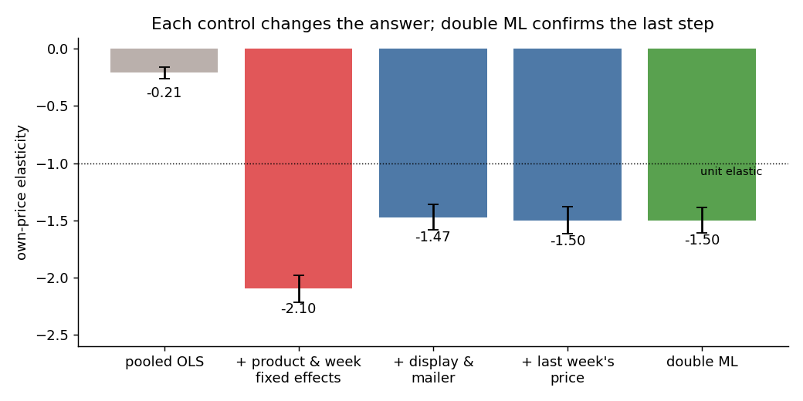
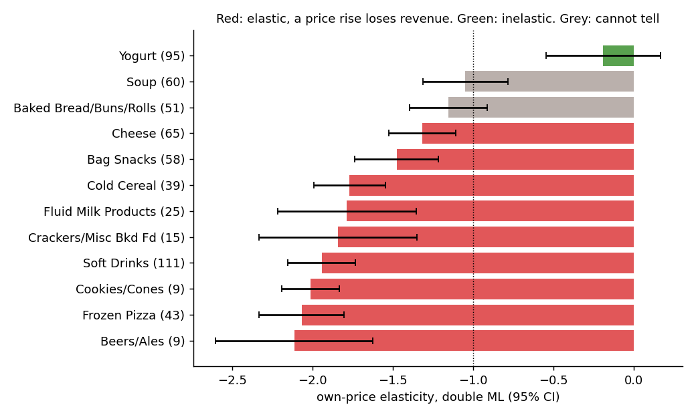

[English ] | [[Español](README.es.md) ]

# How much does a price change move grocery demand?


Two years of real grocery purchases from 2,500 households (dunnhumby, *The Complete Journey*),
with the price each household paid, the loyalty-card discount, and whether each product was on
in-store display or in the weekly mailer. I estimate the own-price elasticity of demand for 580
packaged products in 12 categories, and turn it into the question a category manager asks:
**when does a discount pay for itself?**

The hard part is that prices do not move at random. Products go on sale in the same weeks they
are put on display and in the mailer, and buyers stock up ahead of the next sale. Each step below
removes one of those biases.

## Results

| Estimator | Elasticity | |
|---|---|---|
| Pooled OLS | -0.21 | compares cheap and expensive products, not price changes |
| + product and week fixed effects | -2.10 | a product against its own usual price |
| + display and mailer | -1.47 | promotions lift sales on their own |
| + last week's price | -1.50 | stocking up shifts sales between weeks |
| **Double ML (cross-fitted LightGBM)** | **-1.50** (SE 0.06) | flexible controls, same answer |



**Ignoring promotions overstates price sensitivity by 40%.** With fixed effects alone, a 1% price
cut seems to add 2.1% to sales; once display and mailer are controlled for, it adds 1.5%. The rest
was the promotion, credited to the price.

**Discounts borrow from next week.** A product that was cheap last week sells less this week
(coefficient on last week's relative price +0.11, SE 0.03): part of what a sale "sells" is
purchases brought forward.

**Double ML agrees with the linear model with controls.** Residualising price and sales on
promotions, lags, seasonality and category with LightGBM (folds grouped by product) gives the same
-1.50, so for this panel the linear controls already capture the confounding. 74% of the
within-product price variation is left after removing what the controls predict.

## By category



| Category (products) | Elasticity [95% CI] | Revenue if price +5% | 10% discount pays above gross margin |
|---|---|---|---|
| Beer and ale (9) | -2.11 [-2.61, -1.62] | -5.3% | 50% |
| Frozen pizza (43) | -2.07 [-2.34, -1.80] | -5.1% | 51% |
| Cookies and cones (9) | -2.01 [-2.19, -1.83] | -4.8% | 52% |
| Soft drinks (111) | -1.94 [-2.16, -1.73] | -4.5% | 54% |
| Crackers (15) | -1.84 [-2.34, -1.35] | -4.0% | 57% |
| Fluid milk (25) | -1.79 [-2.22, -1.36] | -3.8% | 58% |
| Cold cereal (39) | -1.77 [-1.99, -1.55] | -3.7% | 59% |
| Bag snacks (58) | -1.48 [-1.74, -1.22] | -2.3% | 69% |
| Cheese (65) | -1.32 [-1.53, -1.11] | -1.5% | 77% |
| Bread and rolls (51) | -1.16 [-1.40, -0.91] | -0.8% | 87% |
| Soup (60) | -1.05 [-1.31, -0.78] | -0.2% | 96% |
| Yogurt (95) | -0.19 [-0.55, 0.17] | +4.0% | never |

**A discount rarely pays for itself on its own product.** A 10% cut raises profit only if the extra
volume outweighs the lost margin per unit. Even in the most price-sensitive category, beer, that
requires a gross margin above 50%; for bread and soup it takes 87-96%. Grocery discounts that make
sense have to earn their keep somewhere else: store traffic, basket size, or supplier funding,
none of which this product-level analysis measures.

**Impulse and treat categories are the most elastic** (beer, frozen pizza, cookies, soft drinks);
**staples are close to unit elastic** (bread, soup), and for those two the interval includes -1,
so the data cannot say whether a price rise would gain or lose revenue. Yogurt is the outlier:
sales barely respond to its price.

## Method

```
transaction_data (2.6M lines) + product + causal_data (36M store-week promotion rows)
   │
   ├── packaged categories sold by the unit; products bought in 60+ of 102 weeks
   ├── product-week panel: units, price paid after loyalty discount, shelf price,
   │   number of stores with display / mailer, last week's relative price
   │
   ├── OLS ladder with product and week fixed effects, errors clustered by product
   ├── double ML: within-product residuals on promotions, lags, seasonality, category
   │   (LightGBM, 5 folds grouped by product), cluster-robust SE
   └── per category: elasticity, revenue response, break-even margin for a 10% cut
```

`causal_data` lists only store-weeks with some promotion, so a share of its rows would be a share
among already-promoted stores; the panel counts promoted stores instead.

## Data

dunnhumby, *The Complete Journey*, via Kaggle
[frtgnn/dunnhumby-the-complete-journey](https://www.kaggle.com/datasets/frtgnn/dunnhumby-the-complete-journey),
license DbCL 1.0. Downloaded October 2026; not redistributed here.

## Reproduce

```powershell
python -m venv venv
.\venv\Scripts\python.exe -m pip install -r requirements.txt
$env:PYTHONPATH = "src"
python -m elastic.panel     # downloads with ~/.kaggle/kaggle.json, builds data/panel.parquet
python -m elastic.model     # ~5 min
python -m elastic.figures
pytest -q tests
```

## Limitations

- These are short-run elasticities identified mostly by temporary promotions. A permanent price
  change usually moves demand less than a sale does.
- Weeks with no purchase in the panel are dropped, because no price is observed; for slow sellers
  this leans toward weeks when the product was cheap.
- Cross-price effects (a discount on one cola taking sales from another) are not modelled, so the
  break-even margins ignore cannibalisation as well as traffic.
- 2,500 households are a panel, not the stores' full sales.

## License

Code: MIT. Data: DbCL 1.0 (dunnhumby via Kaggle), not redistributed.
